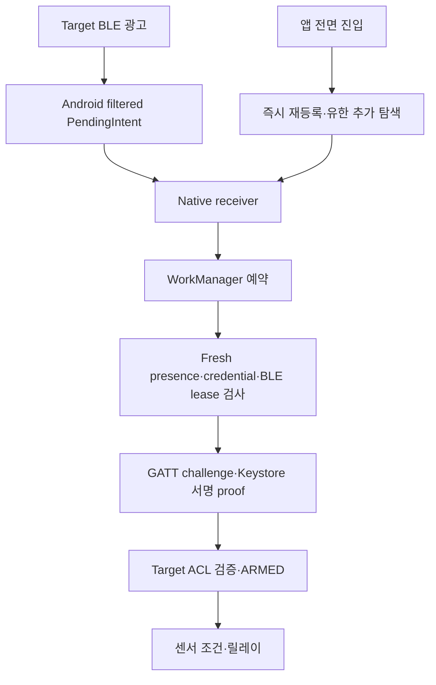

# 화면 OFF·최근 앱에서 닫은 뒤 출입 실패 상세 분석 — 2026-11-04

> Follow-up: [implemented and locally verified](mobile_background_recovery_2026_11_04.md); this original analysis describes the pre-fix baseline. Publication and installation remain pending.

> 분석 완료. 이번 신고의 동일 휴대폰 재현·수정·배포는 미수행. 사용자에게 확인한 ‘앱 종료’는 **최근 앱 목록에서 위로 밀어 닫기**이며 설정의 강제 중지가 아니다.
> 조사: 최신 소스, 고정 의존성 원본, 읽기 전용 Backend 진단, 기존 로컬 검사. 출입·재부팅·OTA·운영 설정 변경 없음.

## 1. 결론

**화면 OFF·UI 종료 상태에서 신호로 native 코드를 깨우고 인증하는 기능은 구현되어 있다. 현재 개선의 중심은 모바일 수신·인증 실행·복구의 신뢰성이다.** 다만 신고자의 특정 실패 원인을 하나로 확정할 증거는 아직 없다.

- 최신 진단이 들어오는 한 대에는 오늘 18:32 **화면 OFF → BLE 수신 → 약 2.7초 내 ARMED → Target 센서·릴레이 완료** 증거가 있다.
- 지원 보고서에는 소유자/모델/최근 앱에서 닫은 상태의 식별 정보가 없어, 이 성공을 신고자의 swipe 종료 후 성공으로 귀속하지 않는다.
- 최근 48시간에 생성되어 최신 report의 세션 링에 남은 16개 session은 ARMED 성공 9개, 실패 7개다. 실패 2개가 **PRESENCE_EXPIRED / FRESH_PACKET_REQUIRED**다.
- 앱을 열면 즉시 등록 복구·추가 탐색이 수행된다. background와의 확실한 차이이며 “열면 된다”와 부합한다.
- ‘상태 확인 필요’는 초기 서버 조회 표시다. native 자동 인증을 직접 막지 않는다. Home 수동 버튼에는 상태 조회 gate가 있다.
- ARMED 이후 sensor timeout 사례도 별도로 존재한다. 인증 성공·릴레이 제어 완료·실제 물리 문 개방을 구분한다.

## 2. 기준과 증거 범위

- primary checkout은 detached a528b82로 이전 NAS 문서가 dirty인 상태다. 기존 수정은 보존했다.
- runtime 코드 기준은 3edc4b42a9f288e8c26fed7c065431dd1f3c6018. 연결된 GitHub에서 최신 612634206f8228500241789390cdd339f1d35a97(PR474 문서 변경)을 확인했다.
- 최신 기존 worktree /home/sh-cat-lee/.codex/worktrees/sgk-ha-log-observation-328의 3469462와 runtime 코드 차이가 없음을 확인하고 read-only 감사에 사용했다.
- 조회 시각: **2026-11-04 20:36–20:49 KST**. Backend 64b5c2f, readiness 12개 true, collector writer alive, fresh authenticated Target status.
- Target boot912, signed IDLE/relay OFF. unsigned firmware 2.1.552+main.g3edc4b4는 공개 manifest와 일치한다. manifest 일치만으로 설치 health를 새로 증명한 것은 아니다.
- 최신 mobile row36169: capture20:36:29.238, receipt20:36:29.740. APK **46101 / 1.0.0-g5053a3a**, Android SDK 보고값37. 공개 mobile manifest와 일치.
- bundle 목록900행(11/3 17:20:25–11/4 20:36:29 KST)은 모두 같은 opaque phone reference였다. next cursor35270이 남아 전체 소진은 아니다. 다른 가족 폰이 없다고 결론내리지 않는다.
- 16회 통계는 **최신 report의 최대50-session ring 중 최근48시간 생성 세션**이다. 전체 출입 시도 수·실패율이 아니다. 일부 실패 세션은 직전 성공 세션 생성 약5초 뒤 시작되어 반복 인증일 가능성도 있다. 별도 물리 출입 실패로 세지 않는다.
- incident Target session cursor는 조회 창에서 소진됐으나 mobile cursor36167과 health truncation은 남아 있다. 일부 페이지의 부재를 사건 부재로 해석하지 않는다.
- 휴대폰 event 시계는 미검증이다. 서버 receipt를 event 발생 시각이나 실제 문앞 도착 시각으로 바꾸지 않는다.

## 3. 자동 인증 경로와 전면/백그라운드 차이

현재 자동 인증은 Flutter의 서버 status 조회나 과거 REST pre-arm을 기다리지 않는다. 7월 mobile_screen_off_incident_analysis.md는 과거 REST 경로 이력이며 현재 경로와 구분한다.

| 항목 | 화면 OFF·UI 없음 | 앱을 열 때 |
|---|---|---|
| 기본 수신 | exact iBeacon manufacturer 필터·LOW_POWER PendingIntent | 동일 + lifecycle 복구 |
| OS callback | FIRST_MATCH/MATCH_LOST + ALL_MATCHES 두 등록 | 동일 + 조건부 ScanCallback |
| 조용한 경로 복구 | quiet watchdog 최소15분 주기, OS 지연 가능 | 최근 수신 없으면 즉시 재등록 |
| 추가 탐색 | 현재 없음 | 3초 grace 후 최대12초 LOW_LATENCY 무필터 |
| 탐색 유지 | 화면OFF·Activity stop이면 취소 | exact·fresh match만 기존 인증으로 전달 |
| 인증·권한 | native credential·Target ACL/proof | 동일 |

근거: BleWakeRegistrar.kt:68–85,137–218; BleForegroundDiscovery.kt:37–94,110–156; MainActivity.kt:36–44.
아래 Android 파일은 gatekeeper_app/android/app/src/main/kotlin/com/kshouse/gatekeeper_app/ 아래 경로 기준이다.

## 4. 실제 수집 결과

### 오늘 18:32 화면 OFF 성공

| 시각 KST | 기록 |
|---|---|
| 18:32:02.424 | BLE_SCAN FIRST_MATCH(type2), screen_interactive=false |
| 18:32:02.518 | WORK_ENQUEUED |
| 18:32:02.520 | WORKER_STARTED: 이 회차 예약→시작 약2ms |
| 18:32:05.170 | mobile SUCCEEDED, presence→ARMED2686ms |
| 서버 receipt18:32:16.972–18:32:18.624 | 같은 Target session의 signed GATT_CONNECTED→PROOF_REQUESTED→PROOF_VERIFIED→ARMED→SENSOR_DETECTED→RELAY_ON→RELAY_OFF→SESSION_COMPLETED |

해당 폰·해당 회차의 화면 OFF 인증과 Target relay 제어 완료 증거다. receipt 지연을 인증 소요시간으로 해석하지 않는다. swipe 여부·신고자 귀속·물리 문 움직임은 미확인이다.

### 최근48시간 보존 세션

| 결과 | 수 |
|---|---:|
| SUCCEEDED: 인증·ARMED 성공 | 9 |
| GATT_DISCONNECTED | 2 |
| PROTOCOL_INCOMPATIBLE / SERVICE_MISSING | 1 |
| PRESENCE_EXPIRED / FRESH_PACKET_REQUIRED | 2 |
| GATT_TIMEOUT | 2 |

session 생성 전500ms 이내 matching wake로 화면 상태를 확인한 성공은 OFF2(오늘07:26·18:32), ON1(어제20:00:44), 나머지6개는 미상이다. 화면 ON은 앱 전면과 동일한 뜻이 아니다.
화면 OFF 실패도 어제19:59:15 PRESENCE_EXPIRED 및20:01:57 GATT_DISCONNECTED로 확인된다. SERVICE_MISSING 코드만으로 실제 앱/Target 버전 불일치를 확정하지 않는다.
최신 report의 전체50-session/wake/native 자료에는 WORKER_STOPPED/PROOF_UNCERTAIN이 없었다. 다른 시점·수집 누락까지 배제하지 않는다.

### 등록 실패와 정상 표시의 한계

- 오늘19:50:30.593 ILLEGAL_STATE →30.612 NATIVE_OWNER_UNAVAILABLE. wake_registered=false/hands_free_ready=false인데 healthy=true였다.
- 19:50:40.634 REGISTERED로 약10초 뒤 복구됐다. 이 실패가 신고된 접근이나 swipe와 동시였는지는 불명이다.
- 뒤이어19:51 recovery는 NO_MATCHING_PACKET. 20:34 foreground recovery도 NO_MATCHING_PACKET.
- 최신 alternative 탐색은 결과151개/candidate0/match0, CANCELLED_ACTIVITY_STOP/RESTORED다. 다른 BLE 관측은 있어도 Gatekeeper 수신은 입증하지 않는다.
- 20:36 snapshot은 native ready/registered=true, battery exemption=true, background restricted=false, device idle=false다. 마지막 matching packet은18:32:24.973, callback은18:32:34.997이다.
- **등록 수락·기능 준비 완료는 최근 RF 수신 증거가 아니다.** 반대로 현재 문앞이라는 자료가 없으므로 2시간 침묵을 고장이라고 단정하지 않는다. 최신 idle=false로 과거 Doze까지 배제하지 않는다.

### 별도 센서 단계와 증거 손실

오늘07:26 화면 OFF 인증은 ARMED 성공했지만 같은 Target session이 약60.116초 뒤 ARM_TIMEOUT으로 끝났다. 센서 요약은 SENSOR_IN_RANGE_NOT_OBSERVED다. 물리 도착·센서 고장·휴대폰 위치 원인은 미확인이다.

mobile cumulative dropped1668/quarantined dropped4, Target unsigned evidence_gap=true/overflow96도 있다. 누적 값이며 이번 신고의 유실 건수로 해석하지 않는다. 신선한 report라도 완전한 사건 기록은 아니다.

## 5. ‘상태 확인 필요’의 의미

Home 초기 _identityStatus는 unavailable이며 accessReady=false,nextAction=status_unavailable다. 이를 ‘상태 확인 필요’로 표시한다.
_refreshIdentity는 status() 후 activity()까지 순차 await한 뒤 화면을 바꾼다. 두 HTTP timeout은 각각10초다. 정상 조회 중 또는 activity 지연만으로도 잠깐 경고가 보일 수 있다.

- 자동 출입 worker는 이 Flutter 상태·API 결과를 읽지 않는다. native flag/credential/session/freshness/lease/proof로 진행한다.
- Home 수동 버튼은 status_unavailable이면 상태만 조회하고 remote-open을 보내지 않는다. 수동 조작 초기 지연은 실제 존재한다.
- 앱 열기에는 별도 Activity resume→scan 복구 효과가 있다. 경고가 사라짐과 출입 회복이 함께 일어나도 경고 해제가 원인이라는 뜻은 아니다.
- status 조회는 기존 공개키/credential/ACL 만료/APPLIED ACK를 확인한다. consent를 켜거나 만료 ACL을 발급하는 호출이 아니다.

근거: gatekeeper_app/lib/screens/smart_key_home_screen.dart:52,326–333,484–500,567–569;
lib/services/mobile_identity_service.dart:75–80,498,530;
gattworker/BleGattCredentialWorker.kt:116–179,247–365,595–597;
BleSecureStorage.kt:362–392; backend/app/acl_management.py:2210–2284.

## 6. 구체적인 모바일 실패 경로

### A. 전면 진입에 집중된 빠른 복구

onResume은 최근30초 패킷이 없으면 즉시 재등록하고 추가 탐색도 제공한다.
background watchdog은 첫 실행부터 최소15분 뒤이며 QUEUED/RUNNING/RETRY_PENDING/PROOF_UNCERTAIN 세션이면 복구를 건너뛴다.
Dart watchdog도 native 등록 authoritative 상태면 조기에 반환한다.
따라서 등록은 수락됐으나 callback이 정체된 경우 앱을 열어야 빨리 회복될 수 있다. **경로 차이는 확정, 이번 신고 인과는 미확정**이다.
근거: blewake/BleWakeReconciliationWorker.kt:19–31,74–79; BleScanRecoveryPolicy.kt:5,22–29; lib/services/ble_scanner.dart:1568–1570.

### B. 수신했어도 인증 실행 전 만료

WorkManager는 즉시 실행을 항상 보장하지 않는다. Android31+ 최초 작업은 expedited지만 quota 부족 시 일반 작업으로 강등되고 부하로도 지연될 수 있다. 현재 Android26–30은 일반 작업이다.

1. 생성 후45초 초과시 PRESENCE_AGE_EXCEEDED.
2. worker 실행시 마지막 RF가5초 이내여야 한다.
3. GATT 연결·발견·challenge·서명 뒤 **proof 직전에도5초를 재검사**한다.

따라서45초 안에 시작해도5초 RF 조건으로 실패할 수 있다. 실제 FRESH_PACKET_REQUIRED2회가 확인됐지만 각 원인이 예약 지연/프로세스 재생성/수신 공백 중 무엇인지는 아직 불명이다.
근거: gattworker/BleGattCredentialWorker.kt:207–223,256–265,304–308,342–345; blewake/ContinuousPresencePolicy.kt:33; gattworker/GattSessionEngine.kt:223–258.

### C. durable session과 메모리 RF 증거의 생명주기 차이

session·암호화 locator는 남아도 ContinuousPresenceTracker는 메모리 전용이다.

수신·예약 → process 종료 → worker 복원 → RF tracker 비어 있음 → 새 packet을 기다리지 않고 terminal PRESENCE_EXPIRED → 다음 fresh packet에도 해당 실패는 빠른 회복 대상이 아니므로60초 backoff가 적용될 수 있다.

**소스로 입증되는 실패 경로**지만 실제 두 실패가 process kill에서 비롯됐다는 증거는 없다. 보안을 위해 오래된 presence를 보존해 무조건 통과시키는 해결은 부적절하다. 새 RF를 유한하게 기다리고 새 증거로 회복해야 한다.
근거: ContinuousPresencePolicy.kt:51–70,77–97; BleGattCredentialWorker.kt:304–308.
기존 BleFieldRecoveryReplayTest.kt:39–59는 메모리 clear 후fresh=false를 검사할 뿐 실제 OS process kill→worker 복원 순서는 검증하지 않는다.

### D. 소유권·GATT·별도 잔존 오류

실제 NATIVE_OWNER_UNAVAILABLE과 disconnected/timeout/service-missing도 있어 수신만 고치면 모든 실패가 사라진다고 할 수 없다. 대체 탐색→기본 등록 복구와 GATT 종료→lease 해제의 인계도 확인해야 한다.
PROOF_UNCERTAIN·single-flight는 안전 규칙이며 무조건 lock 삭제/중복 proof 재전송으로 해결하면 안 된다.

별도 소스 후보: receiver SecurityException은 PERMISSION_DENIED를 저장하고 currentBlockingReason은 현재 권한 정상이어도 저장값을 반환할 수 있다. 명시적 clear 경로를 찾지 못했다. readiness·대체 탐색 eligibility에 영향을 주지만 worker 실행 gate는 아니며 최신 snapshot은 ready다. 이번 원인으로 확정하지 않는다.
근거: blewake/BleWakeScanReceiver.kt:80; gattworker/BleGattCredentialWorker.kt:637–674.

## 7. 최근 앱에서 닫기의 지원 경계

앱 코드에는 swipe시 native PendingIntent를 stop하거나 인증 작업 전체를 취소하는 경로가 없다. Activity stop은 전면 대체 탐색만 취소하고 Dart stopScanning은 스트림·타이머만 정리한다.

flutter_foreground_task6.5.0 공식 archive SHA256 **6cf10a27f5e344cd2ecad0752d3a5f4ec32846d82fda8753b3fe2480ebb832a3**가 pubspec.lock과 일치함을 확인했다. service는 sticky 설정에서 START_STICKY이고 onTaskRemoved 중지 처리가 없다. 앱 manifest에도 stopWithTask=true가 없다. 이 구현이 모든 OS/OEM에서 즉시 재시작됨을 보증하지는 않는다.

따라서 swipe를 설정의 강제 중지와 같다고 설명하면 부정확하다. 화면 OFF·swipe·OS process eviction은 지원 대상으로 검증해야 한다.
별도 설정의 강제 중지는 stopped state이며 Android15+는 PendingIntent도 취소한다. 사용자 재상호작용 전 자동 복구를 약속할 수 없지만 **이번 신고는 그 경우가 아니다**.

키는 setUserAuthenticationRequired(false)로 화면 잠금 해제를 요구하지 않는다(CredentialSigner.kt:74). 재부팅 직후 최초 잠금 해제 전은 별도 조건이며 이번에 검증하지 않았다.

## 8. 수정 우선순위

### P0: 동일 폰의 실패 경계를 화면 독립적으로 보존

- task swipe/process start, receiver→enqueue→worker→proof의 monotonic 시각·process generation·packet age를 연결한다.
- 전면 재등록/대체 탐색 중 어느 경로가 첫 matching packet을 만들었는지 구분한다.
- 기존 동의·bounded journal·durable upload로 앱 화면 없이 보존·재전송·서버 commit·사건 조회를 확인한다.

### P1: native 수신·작업 복구

- 명시적 등록 실패는 bounded 신속 복구하고, 집 밖의 단순 침묵은 고장으로 취급하지 않는다.
- process 재생성 후 worker가 새 RF를 유한하게 기다리도록 개선한다. proof 미전송이 확실한 freshness 실패는 새 RF에 빠르게 회복할 수 있도록 한다.
- receipt→worker/packet→proof 지연을 측정하고 Android가 허용하는 worker 또는 connectedDevice service 실행 조건을 선택한다. 무조건 receiver에서 FGS를 시작한다고 해결되는 것은 아니다.
- 화면 OFF에서 동작하는 적절한 **filtered scan**을 비교한다. foreground 무필터 대체 탐색을 그대로 옮기면 Android screen-off 중단 규칙과 충돌한다.
- ACL/서명/센서 interlock, proof 불확실성 처리, N/N-1, 모바일·Target OTA/rollback을 유지한다.

### P2: 표시·기타 오류

- 초기 checking과 실제 status_unavailable를 분리하고 정상 status를 activity 조회보다 먼저 표시한다.
- 등록 수락·최근 RF·인증 완료·Target relay 완료를 별도 표시한다.
- 현재 권한 재검증 후 과거 blocker를 정리하는 정책을 별도 회귀로 다룬다.

### 합격 조건

격리된 시험으로 등록 실패/수신 정체/process kill 직후 worker 복원/5초 경계/lease 경쟁/권한 복구/불확실한 proof를 먼저 검증한다.
이후 신고 휴대폰에서 ON/OFF/swipe/OS process eviction/장시간 idle/BT OFF-ON/앱 업데이트를 분리하고 RF→worker→proof→ARMED→sensor→relay를 같은 사건으로 연결한다.
실제 문을 무인 반복 개방하지 않는다. 인증 지연과 센서 이후 지연·물리 개폐는 각각 검증한다.

## 9. 검증 및 원본

기존 tests.test_pocket_approach_contract / tests.test_bluetooth_restore_contract / tests.test_continuous_presence **12개 PASS**.
WSL 최신 동일 runtime worktree에서 프로젝트 venv로 실행했다. source contract·host FSM 검증이며 Android 실기기 성공 보증은 아니다.

원본: /tmp/sgk-screenoff-diagnostics-20261104/
- sanitized-evidence-summary.json, recent-sessions-sanitized.json
- detail-36169.json, detail-36123~36126.json, detail-36077~36087.json
- ready.json, access.json, incidents-small.json, mobile-manifest.json, target-manifest.json

큰 incident 응답은 클라이언트1MiB 제한으로 거절돼 축소 조회했다. 불완전 응답을 전체 자료로 사용하지 않았다.
런타임 코드/기기/설정 변경·배포는 없다. 사용자 신고의 동일 폰·실패 시각·swipe 경계까지 연결되지 않아 **장애 수정 완료로 보고하지 않는다**.

## 10. 공식 근거·관련 문서

- [Android background BLE](https://developer.android.com/develop/connectivity/bluetooth/ble/background): 프로세스가 없을 때 PendingIntent와 worker/service 선택지.
- [BluetoothLeScanner](https://developer.android.com/reference/android/bluetooth/le/BluetoothLeScanner): 등록 수락과 수신의 차이, 무필터 화면OFF 중단.
- [WorkManager](https://developer.android.com/develop/background-work/background-tasks/persistent/getting-started/define-work): expedited quota/defer, periodic 최소15분.
- [Android15 stopped state](https://developer.android.com/about/versions/15/behavior-changes-all#stopped-state): 강제 중지의 PendingIntent 취소.
- [고정6.5.0 archive](https://pub.dev/api/archives/flutter_foreground_task-6.5.0.tar.gz): ForegroundService.kt:94–137,319–331 원본 확인.
- [기존 발견 장애](ble_discovery_failure_analysis_2026_09_14.md), [스캔 생애주기](mobile_app_scan_lifecycle.md), [native worker](android_gatt_worker.md), [진단 API](diagnostics_read_api.md), [OTA 계약](ota_reliability_contract.md).
